<picture>
  <source media="(prefers-color-scheme: dark)" srcset="./assets/hero-dark.svg">
  <source media="(prefers-color-scheme: light)" srcset="./assets/hero-light.svg">
  
</picture>

Each mark is one version of the TestTrace desktop client: 872 between 17 May and 29 Oct 2026, up to 24 in one day.

 

I build software inside the team that uses it, and the tests that let it change every day without breaking their work.

## TestTrace

The platform a third-party software testing lab runs its projects on. I am its only developer, and also one of its users. Engineers work in a desktop client where each project is an editable formal document; a Go backend and three Python services generate and parse the nine Word deliverables; an LLM assistant answers questions about a project but can read only what the person asking can read.

**Forward deployed**

- The lab's feedback is the spec. Changes ship as soon as they are verified, each with a one-line note written for the people using it — 2,747 notes so far.
- A version gate on every route stops clients that fall behind, so the backend never keeps two behaviours alive.
- The deliverables are formal Word documents with embedded OLE attachments and filled form controls, laid out the same in Word, LibreOffice and on paper.

**Test engineering**

- 1,700+ Go tests, 3,500+ TypeScript tests, 1,300+ Python tests, and 90 Playwright harnesses that drive the client's real interface in Chromium.
- No fixed sleeps. Every wait is on a concrete signal: an element, a count, a URL, an animation coming to rest.
- An assertion that something did *not* happen first proves the page did something. Otherwise an empty screen passes.
- A new assertion is trusted only after it has failed on purpose: a control run, a deliberate break, and a run with every API response delayed.
- Ratchet tests hold the shape of the code — file length, untyped maps, raw SQL — so it can only get better.

## Other work

**Golden Way Financial** · client project, US tax firm 
A portal where clients upload tax documents through a link. Files are encrypted in the browser, so the server only ever holds ciphertext. Next.js and Supabase, 300+ automated tests, first version delivered in 13 working days. I also built and maintain their [website](https://www.goldenwayfinancial.com) in English, Simplified and Traditional Chinese.

**Document intake** · used on real projects 
Reads a client's pile of specs, contracts, tender files and scans, then fills a long Word application form from it, including an appendix of hundreds of requirement rows. Every row points back to the section it came from.

## Working with me

I ask before I build, ship in steps you can check, and say early when something won't work. I use AI coding tools every day; the tests are how I know what they wrote is right.

Go · TypeScript · React · Tauri · Python · PostgreSQL · Redis · Playwright · Next.js · Supabase

[shangyinwu85@gmail.com](mailto:shangyinwu85@gmail.com) · [Upwork](https://www.upwork.com/freelancers/~0153291fff69e95c79)
